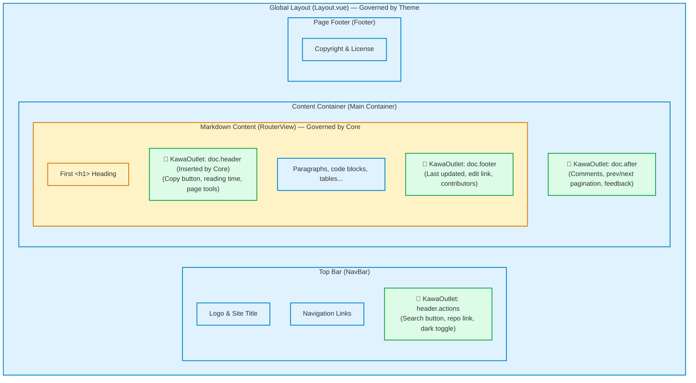

# Theme Architecture & Outlets

In many traditional static site generators, pages are either completely dictated by the theme or require plugins to invasively modify theme templates.

KawaPress uses a cleaner design: **The Socket-and-Plug Model (Outlet System)**.
- **The Theme builds the house**: Uses Vue to lay out the page skeleton (nav bar, content area, footer) and leaves "sockets" (`<KawaOutlet>`) at key spots.
- **The Plugin builds the appliances**: Implements isolated UI features (such as a search button or comments section) and declares which socket it plugs into.
- **KawaPress lays the wiring**: Transports the plugin's components into the theme's corresponding outlets in deterministic order.

Themes never need to know which plugins are installed, and plugins do not care which theme is active. Switching themes keeps all plugin features functioning seamlessly.

## Page Skeleton & Outlet Layout {#page-frame-and-outlets}

A typical KawaPress documentation page is composed of **Theme Components**, **KawaPress Core**, and **Outlets**:



### Four Standard Outlets {#standard-outlets}

KawaPress defines four standard outlets:

| Outlet Name | Placed by | Physical Location | Typical Content |
| :--- | :--- | :--- | :--- |
| `header.actions` | **Theme** places `<KawaOutlet name="header.actions" />` | Right side actions in top navigation bar | Search trigger, repository link, dark mode toggle |
| `doc.header` | **KawaPress Core automatically places**, theme does not write it | Directly beneath the first `<h1>` heading in Markdown | Copy page button, reading time estimate, page tools |
| `doc.footer` | **Theme** places `<KawaOutlet name="doc.footer" />` | Between end of document body and footer | Last updated date, edit-this-page link, contributors |
| `doc.after` | **Theme** places `<KawaOutlet name="doc.after" />` | Outside and directly below the main document body container | Comments (Giscus / Waline), prev/next pagination, feedback |

> **Note**: Except for `doc.header` which is injected automatically by KawaPress when compiling Markdown, all other three outlets are placed freely by the theme in its Vue templates.

## How Themes & Plugins Decouple {#how-they-collaborate}

The sequence diagram below illustrates how a page with search and comments is assembled:

```mermaid
sequenceDiagram
  autonumber
  actor User as Config (kawapress.config.ts)
  participant Theme as Theme Plugin
  participant Core as KawaPress Runtime (Core)
  participant Search as Search Plugin (plugin-search)
  participant Comments as Comments Plugin (plugin-comments)

  User->>Core: Load config plugins: [myTheme(), searchPlugin(), commentsPlugin()]
  Theme->>Core: Mount Layout skeleton (containing header.actions, doc.footer, doc.after)
  Search->>Core: api.addToOutlet('header.actions', { id: 'search', component: SearchButton })
  Comments->>Core: api.addToOutlet('doc.after', { id: 'comments', component: CommentsArea })
  Core->>Theme: Mount SearchButton inside header.actions
  Core->>Theme: Mount CommentsArea inside doc.after
  Note over Theme,Comments: Themes don't import plugins; plugins don't import themes
```

### Responsibility Boundaries {#responsibilities}

| Role | What it must do | What it must never do |
| :--- | :--- | :--- |
| **Theme** | <ul><li>Provide global `Layout.vue` and `NotFound.vue`</li><li>Place `<KawaOutlet>` sockets at structural locations</li><li>Define design tokens (CSS variables via `--kawa-*`)</li></ul> | <ul><li>Hardcode business logic (e.g., search dialogs or comment systems)</li><li>Invade Markdown compilation</li></ul> |
| **Plugin** | <ul><li>Implement self-contained logic and UI components</li><li>Plug into outlets via `api.addToOutlet()`</li><li>Scope default styles in `@layer kawa.plugin` using `--kawa-*` tokens</li></ul> | <ul><li>Assume specific container widths or theme-specific DOM structure</li><li>Override theme global styles or read theme-private tokens (e.g., `--nagi-*`)</li></ul> |
| **Core** | <ul><li>Create Vue app and station client-side router</li><li>Render Markdown to `<RouterView />`</li><li>Automatically mount `doc.header` after the first H1</li><li>Validate outlet registrations and dispatch items in order</li></ul> | <ul><li>Hardcode topbars, sidebars, or default layouts</li><li>Take away visual layout control from the theme</li></ul> |

## Using Outlets in a Theme {#theme-usage}

When authoring `Layout.vue`, `KawaOutlet` is already globally registered:

```vue
<!-- Layout.vue -->
<script setup lang="ts">
import { RouterView } from 'kawapress/client'
</script>

<template>
  <div class="site-layout">
    <!-- 1. Top bar action area -->
    <header class="navbar">
      <div class="brand">My Docs</div>
      <div class="actions">
        <KawaOutlet name="header.actions" />
      </div>
    </header>

    <div class="content-container">
      <main class="main-content">
        <!-- Core renders Markdown and automatically places doc.header after first H1 -->
        <RouterView />

        <!-- 2. Document footer info -->
        <KawaOutlet name="doc.footer" />
      </main>

      <!-- 3. Extended area below document (e.g., comments) -->
      <KawaOutlet name="doc.after" />
    </div>
  </div>
</template>
```

### Customizing Wrapper or Filtering {#customizing-outlet-rendering}

Themes can customize or filter injected components via scoped slots:

```vue
<template>
  <KawaOutlet v-slot="{ items }" name="header.actions">
    <div v-if="items.length > 0" class="theme-actions-bar">
      <component
        :is="item.component"
        v-for="item in items"
        :key="item.id"
      />
    </div>
  </KawaOutlet>
</template>
```

Each `item` provides:
- `id`: Compound key (`plugin-name:plugin-local-id`), e.g., `@kawapress/plugin-search:trigger`.
- `owner`: Plugin package name, e.g., `@kawapress/plugin-search`.
- `component`: The registered Vue component.

## Next Steps {#next-steps}

- [Theme Customization](/guide/theme-customization): Learn how to build a complete theme package from scratch.
- [Plugin Development](/plugins/plugin-development): Learn how to build Generator and Runtime Plugins with `api.addToOutlet()`.
