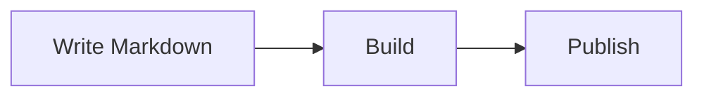
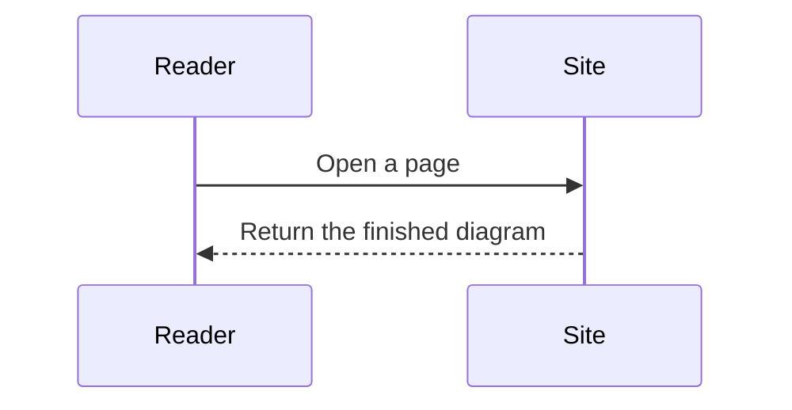
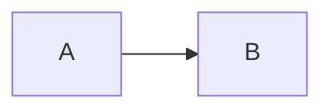

# Mermaid

A diagram made in a drawing tool has to be exported as an image, and fixing one word means starting over. [Mermaid](https://mermaid.js.org) lets you describe a diagram as text, and `@kawapress/plugin-mermaid` draws it.

The drawing is done by [Pele](https://pele.run). It does not need a browser, so diagrams are drawn at build time. Readers see them as soon as the page opens, without waiting for a script.

## Write a diagram {#write-a-diagram}

Use `mermaid` as the language of a code block:

````md

````

This is the result:


Pele supports every diagram type in Mermaid 12.1.0. Here is a sequence diagram:

````md

````


## Three views {#views}

Every diagram has three buttons at its top right:

| Button | What it shows |
| --- | --- |
| Diagram | Only the drawn diagram |
| Code | Only the Mermaid source |
| Side by side | The diagram on the left and the source on the right; stacked on narrow screens |

Use "Side by side" when readers should see how the diagram is written. Keep the default "Diagram" when you only want the picture.

## Zoom {#zoom}

When a diagram is wider than the text, or you want to see details, zoom in:

- Hold `Ctrl` (`⌘` on a Mac) and scroll, or pinch on a touch screen, to zoom around the pointer.
- When zoomed in, drag to move the diagram.
- Double-click to zoom in, and double-click again to reset.
- Two buttons at the top right zoom in and out. A reset button appears once the diagram is zoomed.

Scrolling without `Ctrl` scrolls the page. The diagram does not take the wheel from the reader.

## Choose the starting view {#starting-view}

Add one word after `mermaid` to start this diagram in another view:

````md

````

Use `diagram`, `code` or `split`. The diagram below starts side by side:


To change the default for the whole site, use `defaultView` below.

## Colors follow the theme {#theme}

Diagram colors read the theme's shared variables, so switching between light and dark mode updates them at once without a redraw. To change one kind of color, override the matching Pele variable:

```css
.kawa-mermaid__stage {
  --pele-accent: oklch(0.6 0.2 30);
}
```

See [Pele's theming guide](https://pele.run/theming) for the available variables.

## When a diagram cannot be drawn {#errors}

A syntax error in a diagram does not fail the build. Pele's error message, with the line and column, shows in place of that diagram. Other pages are not affected, and the "Code" view lets you compare it with the source.

## Options {#options}

```ts
import mermaidPlugin from '@kawapress/plugin-mermaid'
import { nagi } from 'kawapress/nagi'

export default nagi({
  plugins: [
    mermaidPlugin({
      defaultView: 'diagram',
      labels: {
        code: 'Source',
      },
      localeLabels: {
        zh: { split: '对照' },
      },
    }),
  ],
})
```

| Option | Description |
| --- | --- |
| `defaultView` | The view a diagram starts in: `diagram` (default), `code` or `split`. A view written in a code block wins. |
| `labels` | Overrides the button texts for every language. |
| `localeLabels` | Overrides the button texts for one language. The key is a name from `locales`. |

You can override `views`, `diagram`, `code`, `split`, `zoomIn`, `zoomOut` and `reset`. English and Chinese are built in, and other languages fall back to English.

## Styles {#styles}

The plugin's styles live in the `kawa.plugin` layer and read only the shared `--kawa-*` variables. To adjust them, override these class names:

| Class | Element |
| --- | --- |
| `.kawa-mermaid` | The whole diagram block |
| `.kawa-mermaid__bar` | The top bar with the view buttons |
| `.kawa-mermaid__view` | One view button |
| `.kawa-mermaid__stage` | The area with the diagram; the Pele color variables are set here |
| `.kawa-mermaid__code` | The area with the source |

## Install {#install}

The nagi preset does not include this plugin, so install it yourself:

::: code-group
```sh [npm]
npm install --save-dev @kawapress/plugin-mermaid
```

```sh [pnpm]
pnpm add --save-dev @kawapress/plugin-mermaid
```

```sh [Yarn]
yarn add --dev @kawapress/plugin-mermaid
```
:::

```ts
import mermaidPlugin from '@kawapress/plugin-mermaid'
import { nagi } from 'kawapress/nagi'

export default nagi({
  plugins: [
    mermaidPlugin(),
  ],
})
```

Adding it to `plugins` is enough. KawaPress loads the component and styles by itself, and pages without a diagram download nothing.

## Limitations {#limitations}

- Pele does not include a math typesetter. `$$…$$` in a diagram shows its TeX source as written.
- Only `mermaid` code blocks are handled. Diagrams written directly in HTML are not.
