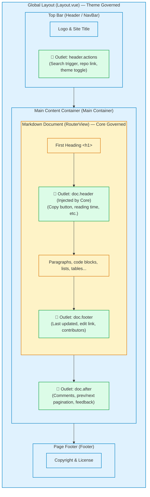
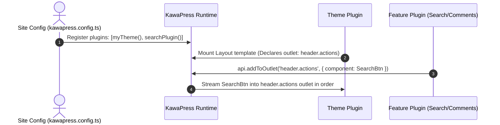

# Theme Development & Outlets

In KawaPress, themes determine the structural skeleton of the page: where the top navigation bar sits, where document content is rendered, how sidebars behave, and how 404 pages look.

Unlike other static site generators, KawaPress follows two primary architectural principles:
1. **A Theme is a regular Plugin**: There is no separate "theme loader". Themes are packaged, distributed, and installed just like regular plugins.
2. **Socket-and-Plug Model (Outlet System)**: Themes provide the structural frame and leave outlets (`<KawaOutlet>`), while plugins inject self-contained UI components into them. Themes and plugins remain completely decoupled.

---

## Page Skeleton & Outlet Layout {#page-frame-and-outlets}

A typical KawaPress documentation page is composed of **Theme Layout Components**, **KawaPress Core Content Area**, and **Four Standard Outlets**.

To ensure balanced visual scaling, the page skeleton is organized vertically:



### Four Standard Outlets {#standard-outlets}

KawaPress defines four standard outlets:

| Outlet Name | Placed by | Physical Location & Purpose | Typical Content |
| :--- | :--- | :--- | :--- |
| `header.actions` | **Theme** places `<KawaOutlet name="header.actions" />` | Right side action area in the top navigation bar | Search trigger, GitHub link, dark toggle |
| `doc.header` | **KawaPress Core**, themes do not write it | Right below first `<h1>` (only appears if H1 exists) | Copy page button, reading time estimate |
| `doc.footer` | **Theme** places `<KawaOutlet name="doc.footer" />` | Information area between document end and footer | Last updated date, edit-this-page link |
| `doc.after` | **Theme** places `<KawaOutlet name="doc.after" />` | Directly outside and below the document container | Comments (Giscus/Waline), prev/next links |

> **Note**: Except for `doc.header` which is injected automatically by KawaPress when compiling Markdown, all other three outlets are placed freely by the theme in its Vue templates.

---

## How Themes & Plugins Decouple {#how-they-collaborate}

Themes and plugins never directly import each other. Here is the interaction lifecycle:



### Responsibility Boundaries {#responsibilities}

| Role | What it must do | What it must never do |
| :--- | :--- | :--- |
| **Theme** | <ul><li>Provide global `Layout.vue` and `NotFound.vue`</li><li>Place `<KawaOutlet>` sockets at structural locations</li><li>Define design tokens (CSS variables via `--kawa-*`)</li></ul> | <ul><li>Hardcode business logic (e.g. search dialogs or comment systems)</li><li>Invade Markdown compilation</li></ul> |
| **Plugin** | <ul><li>Implement self-contained logic and UI components</li><li>Plug into outlets via `api.addToOutlet()`</li><li>Scope default styles in `@layer kawa.plugin` using `--kawa-*` tokens</li></ul> | <ul><li>Assume specific container widths or theme-specific DOM structure</li><li>Override theme global styles or read theme-private tokens (e.g. `--nagi-*`)</li></ul> |
| **Core** | <ul><li>Create Vue app and station client-side router</li><li>Render Markdown to `<RouterView />`</li><li>Automatically mount `doc.header` after the first H1</li><li>Validate outlet registrations and dispatch items in order</li></ul> | <ul><li>Hardcode topbars, sidebars, or default layouts</li><li>Take away visual layout control from the theme</li></ul> |

---

## Two Required Components {#kawapress-requires-two-components}

A theme must register two global components:

| Component | Purpose |
| --- | --- |
| `Layout` | Global page shell for all routes. Must include `<RouterView />` for document display. |
| `NotFound` | The view rendered when a URL does not match any known route. |

Aside from these two component names, KawaPress enforces no rules on your component hierarchy. Navbars, sidebars, and tables of contents can be organized however you see fit.

### 1. `Layout.vue` Places Content and Outlets {#layout-component}

Inside `Layout.vue`, use globally registered `<RouterView />` and `<KawaOutlet />`:

```vue
<!-- Layout.vue -->
<script setup lang="ts">
import { RouterView } from 'kawapress/client'
</script>

<template>
  <div class="my-theme-layout">
    <!-- Navbar -->
    <header class="navbar">
      <div class="logo">My Docs</div>
      <div class="actions">
        <!-- Top bar actions outlet -->
        <KawaOutlet name="header.actions" />
      </div>
    </header>

    <!-- Main Container -->
    <div class="main-container">
      <main class="content">
        <!-- Markdown content rendered here (Core auto-mounts doc.header below H1) -->
        <RouterView />

        <!-- Document footer outlet -->
        <KawaOutlet name="doc.footer" />
      </main>

      <!-- Extended outlet below document (e.g., comments) -->
      <KawaOutlet name="doc.after" />
    </div>
  </div>
</template>
```

#### Customizing Outlet Rendering {#customizing-outlets}

When themes need to wrap or filter injected components, use scoped slots:

```vue
<template>
  <KawaOutlet v-slot="{ items }" name="header.actions">
    <div v-if="items.length > 0" class="theme-actions-box">
      <component
        :is="item.component"
        v-for="item in items"
        :key="item.id"
      />
    </div>
  </KawaOutlet>
</template>
```

Each item provides:
- `id`: Compound identifier, e.g. `@kawapress/plugin-search:trigger`.
- `owner`: Plugin package name, e.g. `@kawapress/plugin-search`.
- `component`: The registered Vue component.

### 2. `NotFound.vue` Handles Missing Pages {#notfound-component}

When a route does not match any document, `RouterView` renders `NotFound`:

```vue
<!-- NotFound.vue -->
<script setup lang="ts">
import { useSite } from 'kawapress/client'

const site = useSite()
</script>

<template>
  <section class="my-theme-not-found">
    <h1>404</h1>
    <p>Page Not Found</p>
    <a :href="site.link">Back to Home</a>
  </section>
</template>
```

---

## Minimal Theme Package Structure {#a-minimal-theme-package}

```text
my-kawapress-theme/
├─ package.json
└─ src/
   ├─ index.ts           Default entry: Generator Plugin
   ├─ runtime-plugin.ts  Runtime entry: Runtime Plugin
   ├─ Layout.vue
   ├─ NotFound.vue
   └─ theme.css
```

### 1. `package.json`

```json
{
  "name": "@example/kawapress-theme",
  "type": "module",
  "version": "0.1.0",
  "exports": {
    ".": {
      "types": "./src/index.ts",
      "import": "./src/index.ts",
      "default": "./src/index.ts"
    },
    "./runtime-plugin": {
      "types": "./src/runtime-plugin.ts",
      "import": "./src/runtime-plugin.ts",
      "default": "./src/runtime-plugin.ts"
    }
  },
  "peerDependencies": {
    "kawapress": "^0.0.1"
  }
}
```

### 2. Generator Entry (`src/index.ts`)

```ts
// src/index.ts
import { definePlugin } from 'kawapress'

export default function myTheme() {
  return definePlugin({
    name: '@example/kawapress-theme',
    setup(api) {
      // Register build-time hooks when needed
    },
  })
}
```

### 3. Runtime Entry (`src/runtime-plugin.ts`)

```ts
// src/runtime-plugin.ts
import { defineRuntimePlugin } from 'kawapress'
import Layout from './Layout.vue'
import NotFound from './NotFound.vue'
import './theme.css'

export default defineRuntimePlugin({
  name: '@example/kawapress-theme',
  setup(api) {
    api.vueApp((app) => {
      app.component('Layout', Layout)
      app.component('NotFound', NotFound)
    })
  },
})
```

---

## Extending `themeConfig` {#theme-config}

Themes can extend the `ThemeConfig` interface to provide full autocompletion and type safety in `defineConfig()`:

```ts
// src/index.ts
declare module 'kawapress' {
  interface ThemeConfig {
    logo?: string
    githubUrl?: string
    sidebar?: Array<{
      text: string
      link: string
    }>
  }
}
```

In theme components, retrieve the configuration with `useThemeConfig()`:

```vue
<script setup lang="ts">
import { useThemeConfig } from 'kawapress/client'

const themeConfig = useThemeConfig()
</script>

<template>
  
</template>
```

---

## Styling Conventions {#styling}

- **Use Standard Tokens**: Consume `--kawa-*` variables (e.g. `--kawa-c-brand`, `--kawa-c-bg`, `--kawa-c-text-1`) so plugins harmonize with your theme automatically.
- **Override Plugins Effortlessly**: Plugin styles live in `@layer kawa.plugin`, so your theme styles override them naturally without `!important`.

For a tested real-world reference, explore [`e2e/fixtures/reference-theme`](https://github.com/kawapress/kawapress/tree/main/e2e/fixtures/reference-theme).
