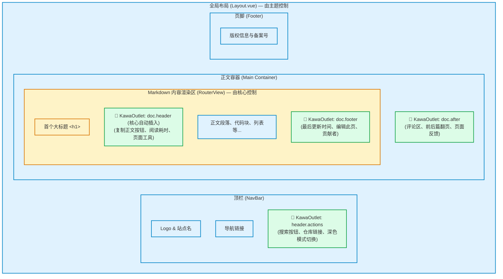
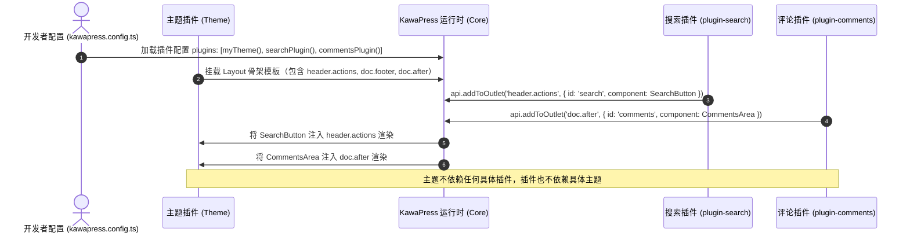

# 主题架构与 Outlet 机制

在很多传统的静态站点生成器中，页面要么由主题全权包揽，要么插件需要侵入式地修改主题模板。

KawaPress 采用了一种更纯粹的设计：**插座与插头模型（Outlet 机制）**。
- **主题是盖房子的**：用 Vue 搭建页面的框架（顶栏、正文区、页脚），并在关键位置留好“插座”（`<KawaOutlet>`）。
- **插件是做电器的**：实现独立的功能界面（如搜索按钮、评论区），声明要把自己插进哪个插座。
- **KawaPress 是铺管线的**：自动把插件的组件按顺序运送到主题对应的插座上渲染出来。

主题不需要知道装了哪些插件，插件也不需要关心当前用的是哪个主题。更换主题时，所有插件功能依然正常显示。

## 页面骨架与 Outlet 分布 {#page-frame-and-outlets}

一个典型的 KawaPress 文档页面由**主题组件**、**KawaPress 核心渲染器**和**插座（Outlet）**共同构成：



### 四个标准 Outlet 规范 {#standard-outlets}

KawaPress 约定了以下四个标准的 Outlet 位置：

| Outlet 名称 | 谁来放置插座 | 页面中的物理位置 | 适合放什么 |
| :--- | :--- | :--- | :--- |
| `header.actions` | **主题** 在顶栏合适位置写 `<KawaOutlet name="header.actions" />` | 页面顶部导航栏右侧的操作区域 | 搜索按钮、GitHub 链接、暗色模式切换开关 |
| `doc.header` | **KawaPress 核心自动放置**，主题无需编写 | Markdown 正文第一个 `<h1>` 标题正下方（只有正文包含 H1 时出现） | 复制 Markdown 按钮、字数统计、阅读时间估算 |
| `doc.footer` | **主题** 在文章正文下方、评论区之前放置 `<KawaOutlet name="doc.footer" />` | 正文末尾与页脚之间的信息区 | 最后更新时间、编辑此页链接、贡献者列表 |
| `doc.after` | **主题** 在正文容器下方放置 `<KawaOutlet name="doc.after" />` | 整个文档正文区域之外的紧接部分 | 评论区（Giscus / Waline）、前后篇翻页导航、读者点赞与反馈 |

> **注意**：除 `doc.header` 是由 KawaPress 在解析 Markdown 时自动注入外，其余三个 Outlet 均由主题在自己的 Vue 模板中决定放置在什么具体 DOM 结构内。

## 主题与插件如何解耦协作？ {#how-they-collaborate}

下面的时序图展示了一个带搜索和评论的页面如何被组装起来：



### 职责边界清单 {#responsibilities}

理解三者的边界能够帮助你写出结构清晰的代码：

| 角色 | 必须负责的事 | 严禁越界做的事 |
| :--- | :--- | :--- |
| **主题 (Theme)** | <ul><li>提供全局 `Layout.vue` 与 `NotFound.vue`</li><li>在骨架上合适的位置摆放 `<KawaOutlet>` 插座</li><li>定义设计变量（CSS Tokens，基于 `--kawa-*`）</li></ul> | <ul><li>不硬编码内置具体业务功能（如强行内置搜索弹窗或评论系统）</li><li>不侵入 Markdown 编译器修改文档 HTML</li></ul> |
| **插件 (Plugin)** | <ul><li>实现独立的业务逻辑和 UI 组件</li><li>通过 `api.addToOutlet()` 把组件挂入插座</li><li>默认样式写在 `@layer kawa.plugin` 并使用 `--kawa-*` 变量</li></ul> | <ul><li>不写死像素级宽度和假定特定的主题 DOM 容器</li><li>不覆盖主题的基础全局样式</li><li>不直接修改主题私有变量（如 `--nagi-*`）</li></ul> |
| **核心 (Core)** | <ul><li>创建 Vue 应用实例与站内路由</li><li>渲染当前页面的 Markdown 内容至 `<RouterView />`</li><li>自动在首个 H1 后挂载 `doc.header`</li><li>按插件配置顺序分发各个插座的内容并进行校验警告</li></ul> | <ul><li>不自带硬编码的顶栏、侧边栏或样式主题</li><li>把所有页面布局呈现权交由主题</li></ul> |

## 主题如何使用 Outlet？ {#theme-usage}

在开发主题的 `Layout.vue` 时，`KawaOutlet` 已经被注册为全局组件，直接在模板中调用即可：

```vue
<!-- Layout.vue -->
<script setup lang="ts">
import { RouterView } from 'kawapress/client'
</script>

<template>
  <div class="site-layout">
    <!-- 1. 顶栏操作区插座 -->
    <header class="navbar">
      <div class="brand">My Documentation</div>
      <div class="actions">
        <KawaOutlet name="header.actions" />
      </div>
    </header>

    <div class="content-container">
      <main class="main-content">
        <!-- 核心负责渲染 Markdown 正文，并在 H1 下自动放置 doc.header -->
        <RouterView />

        <!-- 2. 文档底部信息区插座 -->
        <KawaOutlet name="doc.footer" />
      </main>

      <!-- 3. 正文外部的延伸区插座（如评论） -->
      <KawaOutlet name="doc.after" />
    </div>
  </div>
</template>
```

### 高级：定制插座组件的外壳或过滤 {#customizing-outlet-rendering}

如果主题需要为插座里的组件包装一层带有特定样式的容器，或者想按插件名字筛选组件，可以使用作用域插槽：

```vue
<template>
  <KawaOutlet v-slot="{ items }" name="header.actions">
    <!-- 仅当有插件注入组件时才渲染包装容器 -->
    <div v-if="items.length > 0" class="theme-actions-bar">
      <component
        :is="item.component"
        v-for="item in items"
        :key="item.id"
      />
    </div>
  </KawaOutlet>
</template>
```

每个 `item` 包含以下属性：
- `id`: 插件内部标识与插件名的复合键，如 `@kawapress/plugin-search:trigger`。
- `owner`: 注册该组件的插件名称，如 `@kawapress/plugin-search`。
- `component`: 插件提供的原始 Vue 组件。

## 接下来阅读 {#next-steps}

- [主题定制指南](/guide/theme-customization)：了解如何从零搭建一个完整的主题包和配置 `themeConfig`。
- [插件开发指南](/plugins/plugin-development)：了解如何开发 Generator Plugin 与 Runtime Plugin，以及调用 `api.addToOutlet()`。
