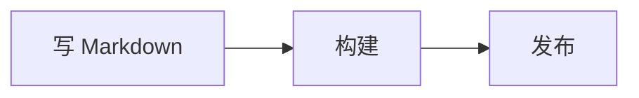
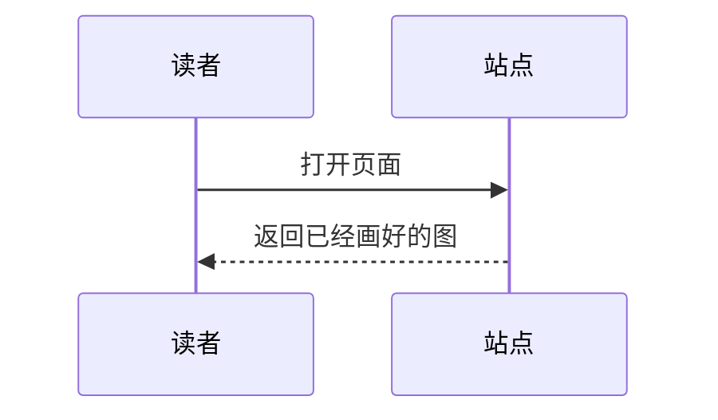
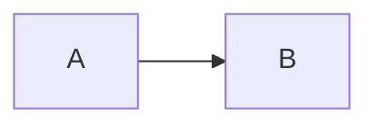

# Mermaid 图表

流程图、时序图这类图，用画图工具做完还得导出图片，改一个字就要重来。[Mermaid](https://mermaid.js.org) 让你直接用文字描述图，`@kawapress/plugin-mermaid` 负责把文字画成图。

画图用的是 [Pele](https://pele.run)。它不需要浏览器，所以图在构建时就画好了，读者一打开页面就能看到，不用等脚本下载。

## 写一张图 {#write-a-diagram}

在代码块的语言处写 `mermaid`：

````md

````

效果如下：


Pele 支持 Mermaid 12.1.0 里的全部图表类型，例如时序图：

````md

````


## 三种视图 {#views}

每张图的右上角有三个按钮：

| 按钮 | 显示什么 |
| --- | --- |
| 图像 | 只显示画好的图 |
| 代码 | 只显示 Mermaid 源码 |
| 并排 | 左边是源码，右边是图，中间的分隔条可以拖动；窄屏幕上改为上下排列，图在上 |

想让读者看到源码怎么写，用「并排」；只想放一张图，保持默认的「图像」。

## 缩放 {#zoom}

图比正文宽，或者想看清细节时，可以缩放：

- 按住 `Ctrl`（Mac 上是 `⌘`）再滚动滚轮，或在触摸屏上双指捏合，以指针位置为中心缩放。
- 放大之后，按住拖动可以平移。
- 双击放大，再次双击还原。
- 图的右上角有放大、缩小两个按钮；放大之后会多出一个还原按钮。

不按 `Ctrl` 直接滚动滚轮，滚动的是页面，不会被图抢走。

## 指定起始视图 {#starting-view}

在 `mermaid` 后面加一个词，就能让这一张图一开始显示别的视图：

````md

````

可以写 `diagram`、`code` 或 `split`。下面这张图就从「并排」开始：


想让整个站点默认如此，用 `defaultView`，见下文。

## 颜色跟随主题 {#theme}

图的颜色读取的是主题的公共变量，切换明暗模式时图会立刻跟着变，不用重新画。想改某一类颜色，覆盖对应的 Pele 变量即可：

```css
.kawa-mermaid__stage {
  --pele-accent: oklch(0.6 0.2 30);
}
```

可用的变量见 [Pele 的主题文档](https://pele.run/theming)。

## 画不出来时 {#errors}

图里有语法错误时，构建不会失败。这张图的位置会显示 Pele 给出的错误信息（包含出错的行和列），其他页面不受影响，你还可以切到「代码」视图对照源码。

## 配置 {#options}

```ts
import mermaidPlugin from '@kawapress/plugin-mermaid'
import { nagi } from 'kawapress/nagi'

export default nagi({
  plugins: [
    mermaidPlugin({
      defaultView: 'diagram',
      labels: {
        code: '源码',
      },
      localeLabels: {
        en: { split: 'Both' },
      },
    }),
  ],
})
```

| 选项 | 说明 |
| --- | --- |
| `defaultView` | 图一开始显示的视图，可以是 `diagram`（默认）、`code` 或 `split`。单张图在代码块里写的视图优先。 |
| `labels` | 覆盖所有语言的按钮文字。 |
| `localeLabels` | 只覆盖某一种语言的按钮文字，键是 `locales` 里的语言名。 |

可以覆盖的文字有 `views`、`diagram`、`code`、`split`、`zoomIn`、`zoomOut`、`reset`。内置中文和英文，其他语言回退英文。

## 样式 {#styles}

插件的样式放在 `kawa.plugin` 样式层，只读取公共的 `--kawa-*` 变量。需要微调时，覆盖这些类名：

| 类名 | 对应的元素 |
| --- | --- |
| `.kawa-mermaid` | 整个图表块 |
| `.kawa-mermaid__bar` | 顶部放视图按钮的一栏 |
| `.kawa-mermaid__view` | 一个视图按钮 |
| `.kawa-mermaid__stage` | 放图的区域，Pele 的颜色变量设置在这里 |
| `.kawa-mermaid__code` | 放源码的区域 |

## 安装 {#install}

nagi 预设没有内置这个插件，需要单独安装：

::: code-group
```sh [npm]
npm install --save-dev @kawapress/plugin-mermaid
```

```sh [pnpm]
pnpm add --save-dev @kawapress/plugin-mermaid
```

```sh [Yarn]
yarn add --dev @kawapress/plugin-mermaid
```
:::

```ts
import mermaidPlugin from '@kawapress/plugin-mermaid'
import { nagi } from 'kawapress/nagi'

export default nagi({
  plugins: [
    mermaidPlugin(),
  ],
})
```

加入 `plugins` 就够了。需要用到的组件和样式，KawaPress 会自动加载；页面里没有图表时，什么都不会下载。

## 注意事项 {#limitations}

- Pele 不包含数学公式排版。图里的 `$$…$$` 会按原样显示 TeX 源码。
- 图只处理代码块里的 `mermaid`。直接写在 HTML 里的图不会被处理。
