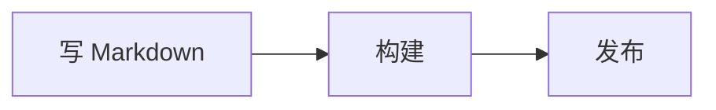

# @kawapress/plugin-mermaid

KawaPress Markdown 的 Mermaid 图表，由 Pele 在构建时绘制，带缩放和代码视图。

[](https://www.npmjs.com/package/@kawapress/plugin-mermaid) · [English](https://github.com/kawapress/kawapress/blob/main/packages/plugin-mermaid/README.md)

`@kawapress/plugin-mermaid` 是 [KawaPress](https://github.com/kawapress/kawapress) 的一部分。KawaPress 是一个以 Vue 为核心的静态站点生成器。

## 特性

- 写一个 `mermaid` 代码块就得到 SVG 图表。不需要浏览器，页面一打开读者就能看到。
- 每张图有三种视图：图像、代码，以及可拖动分隔条的并排视图。
- 用 `Ctrl`/`⌘` 加滚轮、双指捏合、双击或按钮缩放，页面依然正常滚动。
- 颜色跟着站点主题走，浅色和深色切换时不用重绘。
- 语法错误时，在该图的位置显示 Pele 给出的错误信息，不会让构建失败。

## 安装

```sh
npm install --save-dev @kawapress/plugin-mermaid
```

也可以用 `pnpm add --save-dev @kawapress/plugin-mermaid` 或 `yarn add --dev @kawapress/plugin-mermaid`。

## 使用

````md

````

```ts
import mermaidPlugin from '@kawapress/plugin-mermaid'
import { nagi } from 'kawapress/nagi'

export default nagi({
  plugins: [mermaidPlugin()],
})
```

用 `mermaid code` 或 `mermaid split` 可以让单张图从别的视图开始。

## 配置项

| 选项 | 说明 |
| --- | --- |
| `defaultView` | 图表开始时的视图：`diagram`（默认）、`code` 或 `split`。 |
| `labels` | 改写所有语言的按钮文字。 |
| `localeLabels` | 改写某一种语言的按钮文字。 |

## 文档

[文档](https://kawapress.dev/plugins/mermaid) · [反馈问题](https://github.com/kawapress/kawapress/issues)

## 许可证

[MIT](https://github.com/kawapress/kawapress/blob/main/LICENSE) © KawaPress contributors
