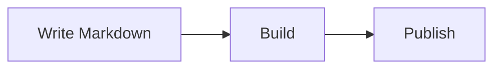

# @kawapress/plugin-mermaid

Mermaid diagrams for KawaPress Markdown, drawn at build time by Pele, with zoom and code views.

[](https://www.npmjs.com/package/@kawapress/plugin-mermaid) · [简体中文](https://github.com/kawapress/kawapress/blob/main/packages/plugin-mermaid/README-zh-CN.md)

`@kawapress/plugin-mermaid` is part of [KawaPress](https://github.com/kawapress/kawapress), a Vue-first static site generator.

## Features

- Write a `mermaid` code block and get an SVG diagram. No browser is needed, so readers see it as soon as the page opens.
- Three views per diagram: diagram, code, and side by side with a draggable divider.
- Zoom with `Ctrl`/`⌘` and the wheel, pinch, double-click, or the buttons. The page still scrolls normally.
- Colors follow the site theme, so light and dark switch without a redraw.
- A syntax error shows Pele's message in place of that diagram and does not fail the build.

## Install

```sh
npm install --save-dev @kawapress/plugin-mermaid
```

`pnpm add --save-dev @kawapress/plugin-mermaid` and `yarn add --dev @kawapress/plugin-mermaid` work too.

## Usage

````md

````

```ts
import mermaidPlugin from '@kawapress/plugin-mermaid'
import { nagi } from 'kawapress/nagi'

export default nagi({
  plugins: [mermaidPlugin()],
})
```

Start one diagram in another view with `mermaid code` or `mermaid split`.

## Options

| Option | Description |
| --- | --- |
| `defaultView` | The view a diagram starts in: `diagram` (default), `code` or `split`. |
| `labels` | Override the button texts for every language. |
| `localeLabels` | Override the button texts for one language. |

## Documentation

[Documentation](https://kawapress.dev/en/plugins/mermaid) · [Report a problem](https://github.com/kawapress/kawapress/issues)

## License

[MIT](https://github.com/kawapress/kawapress/blob/main/LICENSE) © KawaPress contributors
